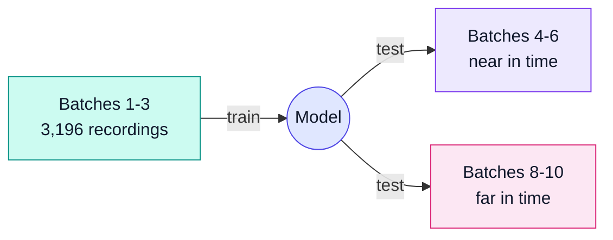
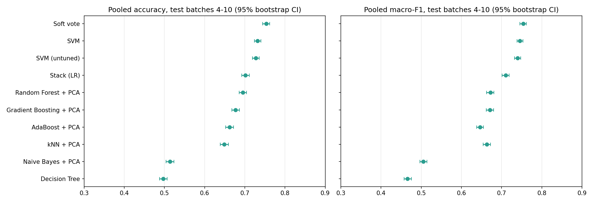
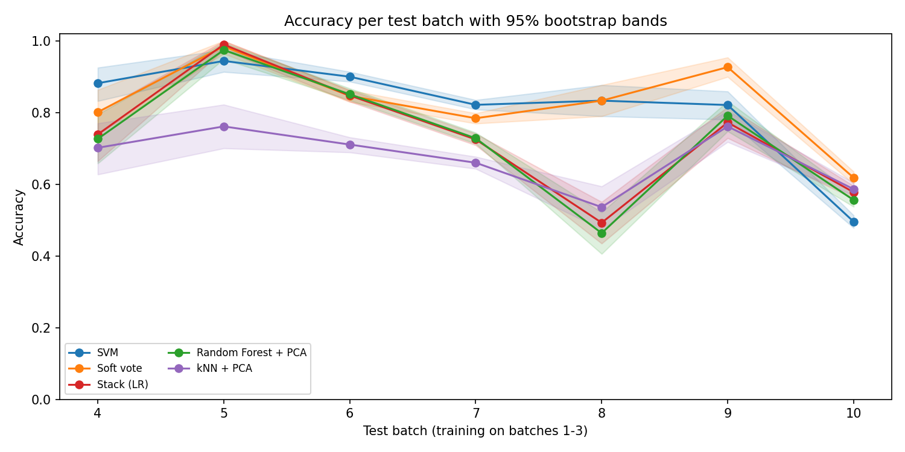
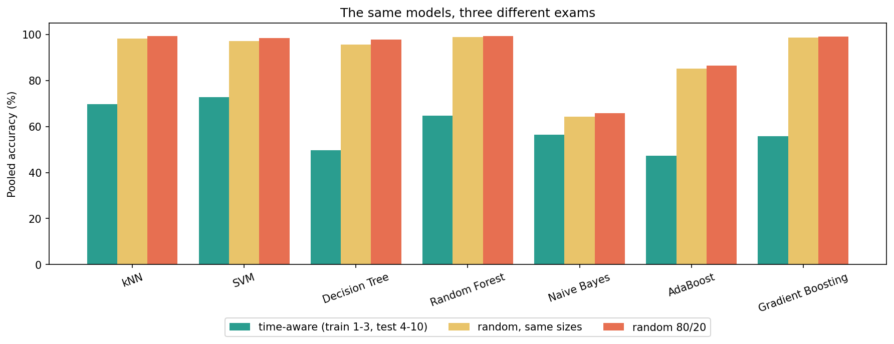
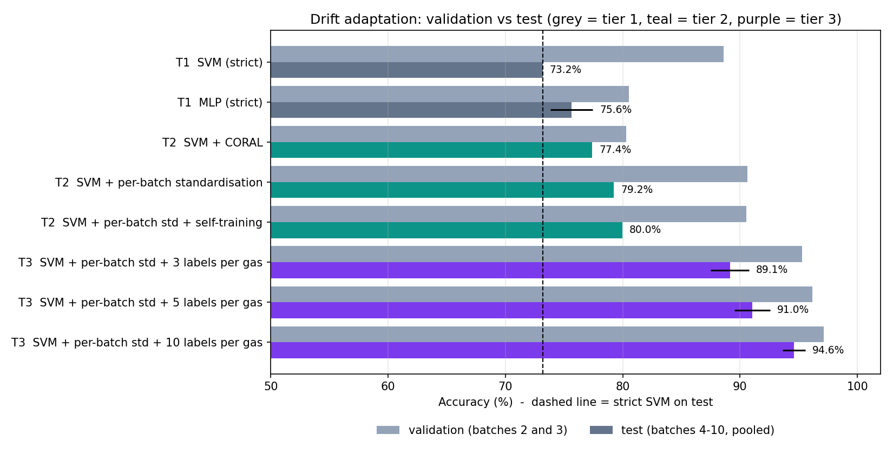

<div align="center">

# Drift-Robust Gas Classification

**Can a model keep recognising gases as its sensors age?**

A time-aware machine-learning study of sensor drift on the UCI Gas Sensor Array Drift dataset,<br>
with an interactive dashboard that shows every result.

[](https://drift-robust-gas-classification-ctfmhqhdsllpacizk7et2b.streamlit.app/)


[**🚀 Live app**](https://drift-robust-gas-classification-ctfmhqhdsllpacizk7et2b.streamlit.app/) · [Results](#main-results) · [Dashboard](#interactive-dashboard) · [Conclusions](#conclusions) · [Reproduce](#how-to-reproduce)

</div>

---

## The answer in 30 seconds

Metal-oxide gas sensors change as they age, so a model trained on early recordings slowly stops recognising the same gases.
We trained classical models on the **first three batches** and tested them on the **seven later ones**.

| | |
|:--|:--|
| 🎯 **73.2%** | best single model (SVM) on later batches; a soft vote of five models reaches 75.5% |
| 📉 **90.3% → 55.4%** | the SVM on batches close to training vs. batches furthest away |
| 🎭 **97.2%** | what the same SVM *appears* to score with a random split; it hides the drift |
| 🔁 **88.6%** | with recent labelled data (retraining before each batch) |
| 🧪 **79.2% / 91.0%** | bonus: rescaling each new batch on its own (no labels) / plus 5 labels per gas per batch |

**Short answer: no, not fully.** Drift costs 11-35 points of accuracy, and no classical trick tested here (PCA, LDA,
boosting, tuning, stacking) clearly fixes it. Using the new batches' own readings, or a few of their labels, does help.

## How we test fairly



- **Data.** [UCI Gas Sensor Array Drift](https://doi.org/10.24432/C5RP6W): 16 sensors, 128 features per recording, 36 months,
  10 time-ordered batches. Toluene is removed (it is missing from batches 3-5), leaving **12,077 samples and 5 gases**
  over 10 batches of 371, 1,239, 1,586, 161, 197, 1,833, 3,045, 276, 369 and 3,000 samples.
- **Protocols.** **A** (headline): train on batches 1-3, test on 4-10. **B**: train on batch 1, test on each later batch.
  **C**: retrain on all earlier batches before each test batch.
- **No leakage.** Scaling, PCA and LDA live inside the pipeline and see training batches only; tuning uses forward-in-time
  folds inside batches 1-3. Tests prove the test batches cannot change anything that was fitted.
- **Models.** kNN, SVM, Decision Tree, Random Forest, Naive Bayes, AdaBoost and Gradient Boosting, each with no reduction,
  PCA or LDA, plus a stacking ensemble and a soft vote. Scored with accuracy and macro-F1, bootstrap 95% intervals and 10 seeds.

## Main results

Every table below is checked against the saved files in `results/` by `tests/test_readme_numbers.py`.

### Headline: pooled accuracy on batches 4-10

Mean ± standard deviation over 10 seeds, tuned settings, each model with the reduction that won on validation.

| Model | Accuracy (mean ± std) | Macro-F1 |
|---|---|---|
| Soft vote | 75.5% ± 0.14 | 75.5% |
| SVM | 73.2% ± 0.00 | 74.5% |
| Random Forest + PCA | 69.9% ± 0.59 | 67.4% |
| Stack (LR) | 69.5% ± 0.40 | 70.6% |
| Gradient Boosting + PCA | 67.7% ± 0.03 | 67.1% |
| AdaBoost + PCA | 66.2% ± 0.00 | 64.6% |
| kNN + PCA | 64.9% ± 0.00 | 66.3% |
| Decision Tree | 52.6% ± 1.54 | 48.7% |
| Naive Bayes + PCA | 51.4% ± 0.00 | 50.5% |

Guessing the most common gas scores 21-23%.

<p align="center"></p>

### Drift: the further from training, the worse

| Model | Near batches 4-6 | Far batches 8-10 | Change (points) |
|---|---|---|---|
| SVM | 90.3% | 55.4% | -34.9 |
| Soft vote | 85.6% | 66.6% | -19.0 |
| Stack (LR) | 85.3% | 59.1% | -26.1 |
| Random Forest + PCA | 85.3% | 57.3% | -28.0 |
| kNN + PCA | 71.5% | 60.0% | -11.4 |

No model exceeds 67% on the far batches, and batch 10 is hard for all of them (34-62%).

<p align="center"></p>

### The random-split trap

The same models and settings under three exams. "Random, same sizes" matches protocol A's sizes, so only time order differs.

| Model | Time-aware (A) | Random, same sizes | Random 80/20 |
|---|---|---|---|
| kNN | 69.6% | 98.3% | 99.3% |
| SVM | 72.7% | 97.2% | 98.4% |
| Decision Tree | 49.7% | 95.6% | 97.9% |
| Random Forest | 64.7% | 99.0% | 99.4% |
| Naive Bayes | 56.5% | 64.2% | 65.8% |
| AdaBoost | 47.2% | 85.2% | 86.6% |
| Gradient Boosting | 55.8% | 98.7% | 99.2% |

In a random split, 98% of test recordings have a near-twin from the same session in the training set, so models pass by
recognition. It also picks the wrong winner: Gradient Boosting looks like 99% but scores 55.8% under drift.

<p align="center"></p>

<details>
<summary><b>With recent labelled data (protocol C)</b></summary>

<br>

Mean per-batch accuracy on batches 4-10 when each model is retrained on all earlier batches. A different, easier task,
so it is kept out of the headline.

| Model | Mean accuracy |
|---|---|
| SVM | 88.6% |
| Stack (LR) | 87.0% |
| Soft vote | 85.3% |

</details>

### Bonus: drift adaptation (Step 13)

What if a method may use something from each new batch? **Tier 2** methods use the batch's sensor readings but never its
gas labels; **tier 3** methods also get a few labelled recordings per gas, which are left out of the score. All use the
tuned SVM. A method counts as an improvement only if it also beats the strict SVM on the Step 8 validation folds
(batches 2 and 3), so nothing is chosen by looking at the test batches. These numbers use information protocol A
forbids, so they are kept apart from the headline.

| Method | Tier | Validation | Test, batches 4-10 | Batch 10 |
|---|---|---|---|---|
| SVM (strict) | 1 | 88.6% | 73.2% | 49.6% |
| MLP (strict) | 1 | 80.5% | 75.6% | 58.6% |
| SVM + CORAL | 2 | 80.3% | 77.4% | 52.7% |
| SVM + per-batch standardisation | 2 | 90.6% | 79.2% | 63.3% |
| SVM + per-batch std + self-training | 2 | 90.5% | 80.0% | 65.2% |
| SVM + per-batch std + 3 labels per gas | 3 | 95.3% | 89.1% | 78.5% |
| SVM + per-batch std + 5 labels per gas | 3 | 96.2% | 91.0% | 82.2% |
| SVM + per-batch std + 10 labels per gas | 3 | 97.1% | 94.6% | 89.9% |

**Per-batch standardisation**, which scales each batch with its own mean and spread, is the fair tier-2 winner: +6.0
points with no test labels. The MLP and CORAL look better on test but worse on validation, so they are not counted.
The gain is uneven: per-batch scaling loses 25 points on batch 8, which is 52% Acetone, because it assumes a balanced
gas mix. A few labels fix that and give the largest gains (tier-3 rows: mean of 10 seeds).

**Using the same labels more cleverly did not help.** With 25 random labels per new batch the SVM scores 96.2% on
validation and 92.1% on test. Labelling the recordings the model is least sure about (active learning), weighting the
labels, self-training, the soft vote and four other SVM settings never beat that on validation. Some reach 93.0% on
test, but only a choice made by looking at the test batches would pick them. More labels is what helps.

<p align="center"></p>

## Conclusions

1. **Drift is real and large.** The tuned SVM falls from 90.3% to 55.4%. Errors are structured: the SVM tends to label other
   gases as Ethanol, and Ammonia holds up best: only 1 of the 10 analysed models finds fewer than 40% of Ammonia recordings in any batch,
   against 4 to 8 of 10 for each other gas.
2. **The best honest accuracy is about 73-75%.** The soft vote leads when pooled, but batch by batch it wins 3, loses 3 and
   ties 1 against the SVM, so it is not clearly better.
3. **PCA and LDA are not a drift fix.** They help weak models and hurt strong ones.
4. **Boosting and tuning did not help clearly.** 5 of 21 model/reduction combinations improved, 7 stayed about the same and
   9 got worse. Validation on nearby batches does not predict later batches (correlation -0.14; validation was on average
   8.9 points too optimistic), itself a sign of drift.
5. **Stacking did not beat the best single model** (69.5% vs 73.2%).
6. **Random splits mislead**: 96-99% instead of 50-73%, the drift disappears and the ranking changes.
7. **Recent labels help most** (protocol C: 85-89%), but they cost labelling every new batch.
8. **Adapting to each new batch helps** (bonus, Step 13): per-batch standardisation lifts the SVM to 79.2% without labels,
   and 5 labels per gas per batch reach 91.0%, more than protocol C with far fewer labels.

## Interactive dashboard

**Try it live: [drift-robust-gas-classification-ctfmhqhdsllpacizk7et2b.streamlit.app](https://drift-robust-gas-classification-ctfmhqhdsllpacizk7et2b.streamlit.app/)**

Nine pages that show the data, the drift and every result, plus a live demo where you pick a recording and watch the models
vote. It only displays what the notebooks measured, and tests check the numbers on screen.

```bash
pip install -r app/requirements.txt
streamlit run app/app.py
```

**Overview** · **Data explorer** · **Drift viewer** (with a play-through-time animation) · **Model results** ·
**Per-batch drift** · **Confusion matrices** · **Random vs time-aware** · **Live demo** · **Limitations**

<details>
<summary><b>Deploy it for free</b></summary>

<br>

Streamlit apps need a long-running server, so serverless hosts such as Vercel cannot run them. Use
[Streamlit Community Cloud](https://share.streamlit.io):

1. Sign in with GitHub and choose **Create app → Deploy a public app from GitHub**.
2. Pick this repository, branch `main`, main file path `app/app.py`.
3. Under **Advanced settings** choose Python 3.11, pick a `*.streamlit.app` address and deploy.

The cloud installs the lean `app/requirements.txt` and reads the theme from `.streamlit/config.toml`.

</details>

## Limitations

- **Five gases only**, and **gas concentration is not in this dataset version**, so it cannot be separated from ageing.
- **Small, uneven batches** (4, 5, 8 and 9 hold 161-369 samples) make single-batch results noisy.
- **One training period** (batches 1-3); seeds and bootstrap intervals do not cover other choices.
- **Intervals are too narrow**: the bootstrap treats neighbouring recordings as independent.
- **Tuned models are tested on protocol A only**, with small grids and two validation folds.
- **The Dennler et al. (2022) baseline check** needs raw data this version lacks; we use clearly labelled proxies.
- **One dataset**: conclusions may not transfer to other sensors.

## How to reproduce

```bash
python -m venv .venv && .venv\Scripts\activate
pip install -r requirements.txt

python -m pytest tests -q            # full test suite, about 40 s
streamlit run app/app.py             # dashboard
```

All results are already saved in `results/`, so the notebooks can simply be read. To recompute them:

<details>
<summary><b>Step-by-step commands and timings</b></summary>

<br>

```bash
# Steps 1-7: run notebooks/01 ... 07 in order (07 is the slowest, about 25 min)
python scripts/run_step8_tuning.py     # about 19 min, then notebook 08
python scripts/run_step9_stacking.py   # about 11 min, then notebook 09
#                                        notebook 10 (under a minute)
python scripts/run_step11_leakage.py   # about 20 min, then notebook 11
python scripts/run_step12_repeats.py   # about 6 min,  then notebook 12
python scripts/run_step13_adaptation.py # about 5 min, then notebook 13 (bonus)
python scripts/make_dashboard_cache.py # optional: saves predictions so the dashboard opens faster
```

Run a notebook headless with `jupyter nbconvert --to notebook --execute --inplace notebooks/<name>.ipynb`.
On Windows, if pip fails with `CERTIFICATE_VERIFY_FAILED`, add `--use-feature=truststore`.

</details>

## Where each number comes from

<details>
<summary><b>Result files and notebooks</b></summary>

<br>

| Numbers | File | Notebook |
|---|---|---|
| Sample counts, Toluene removal | `results/step1_counts.csv` | `01_load_and_remove_toluene` |
| Untuned baselines | `results/step5_protocolA_summary.csv` | `05_baseline_models` |
| PCA / LDA effect | `results/step6_protocolA_summary.csv` | `06_pca_lda` |
| Boosting | `results/step7_protocolA_all_models.csv` | `07_boosting` |
| Tuning, validation vs test | `results/step8_tuned_vs_untuned.csv` | `08_tuning` |
| Stack, soft vote, protocol C | `results/step9_stacking_metrics.csv` | `09_stacking` |
| Intervals, near vs far, confusion matrices | `results/step10_*.csv` | `10_drift_analysis` |
| Random vs time-aware split | `results/step11_accuracy_table.csv` | `11_leakage_check` |
| Headline mean ± std over seeds | `results/step12_summary.csv` | `12_repeated_runs` |
| Bonus drift adaptation | `results/step13_summary.csv` | `13_drift_adaptation` |
| Bonus: using 25 labels per batch | `results/step13_label_strategies_summary.csv` | `13_drift_adaptation` |

</details>

<details>
<summary><b>Repository layout</b></summary>

<br>

```
app/          Streamlit dashboard (app.py, design.py, ui.py, motion.js, views/)
data_raw/     original batch files, never modified
notebooks/    one notebook per step, with results and explanations
results/      saved tables, figures and trained models
scripts/      long-running, restartable jobs (Steps 8, 9, 11, 12, 13)
src/          loading, evaluation, models, tuning, stacking, analysis, adaptation
tests/        data-integrity, leakage, dashboard and README-number checks
```

</details>

## References

<details>
<summary><b>Six papers</b></summary>

<br>

1. Vergara, A., Vembu, S., Ayhan, T., Ryan, M. A., Homer, M. L., & Huerta, R. (2012). Chemical gas sensor drift compensation
   using classifier ensembles. *Sensors and Actuators B: Chemical*, 166-167, 320-329. doi:10.1016/j.snb.2012.01.074
2. Vergara, A. (2012). Gas Sensor Array Drift Dataset. UCI Machine Learning Repository. doi:10.24432/C5RP6W
3. Dennler, N., Rastogi, S., Fonollosa, J., van Schaik, A., & Schmuker, M. (2022). Drift in a popular metal oxide sensor
   dataset reveals limitations for gas classification benchmarks. *Sensors and Actuators B: Chemical*, 361, 131668.
   doi:10.1016/j.snb.2022.131668
4. Zhang, Y., et al. (2022). TDACNN: Target-domain-free domain adaptation CNN for drift compensation in gas sensors.
   *Sensors and Actuators B: Chemical*, 361, 131739. doi:10.1016/j.snb.2022.131739
5. Jiang, K., et al. (2025). Gas sensor drift compensation using semi-supervised ensemble classifiers with multi-level
   features and center loss. *ACS Sensors*, 10(4), 2906-2918. doi:10.1021/acssensors.4c03655
6. Lin, J., & Zhan, X. (2026). Sensor-drift compensation in electronic-nose-based gas recognition using knowledge
   distillation. *Informatics*, 13(1), 15. doi:10.3390/informatics13010015

</details>
