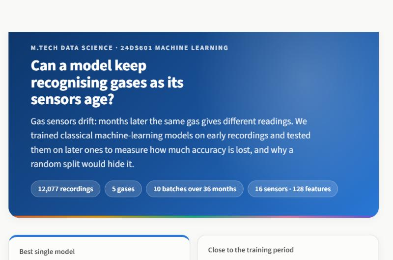
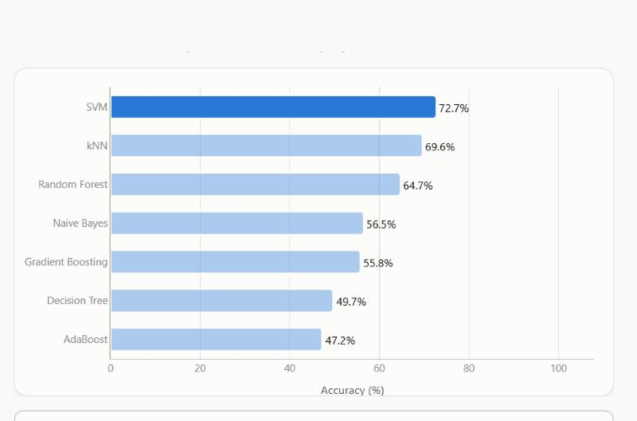
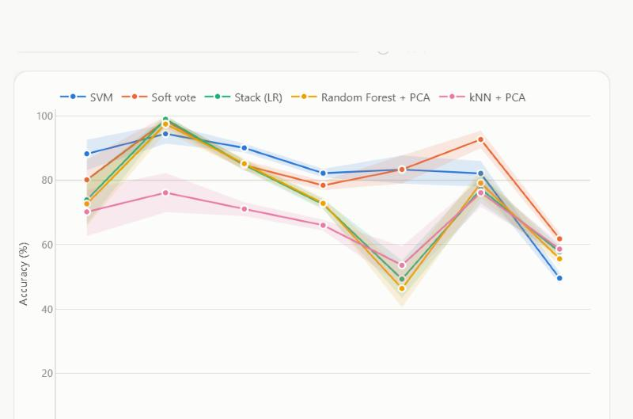
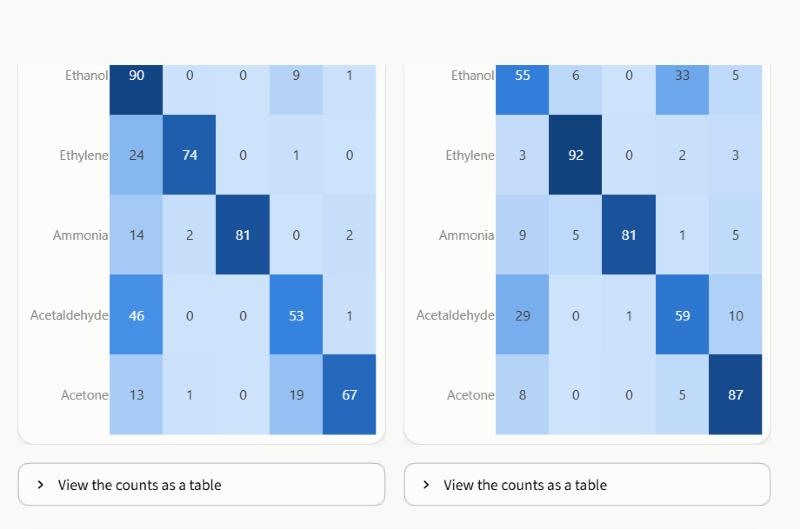
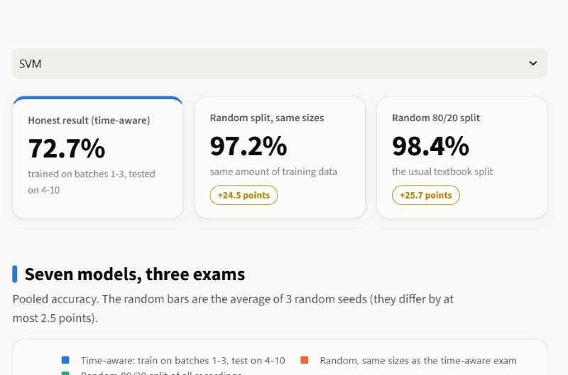
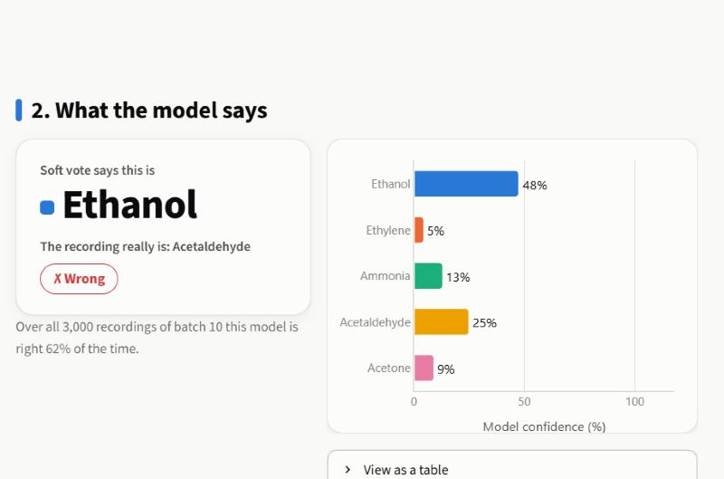

# Drift-Robust Gas Classification Using Machine Learning

A machine-learning case study on sensor drift.

## What this project is about

Metal-oxide gas sensors change as they age, so a model trained on early recordings loses accuracy on later ones. This
is called **sensor drift**. We use the UCI Gas Sensor Array Drift dataset to ask:

> Can a classical ML model keep identifying gases correctly when sensor characteristics change over time?

To answer it fairly we train on the early batches and test on the later ones (a **time-aware** split), compare
classical models, test whether PCA/LDA, boosting, tuning and stacking help, and show how misleading a random split is.

**Short answer:** no, not fully. The best honest accuracy on later batches is about **73-75%** (pooled over batches 4-10),
and it falls from about 90% on batches close to the training period to about 55-67% on the far batches. The details,
the evidence and the limits are below. The full step-by-step plan is in [PROJECT_PLAN.md](PROJECT_PLAN.md).

## Dataset

[UCI Gas Sensor Array Drift Dataset](https://doi.org/10.24432/C5RP6W) (Vergara et al., 2012): 16 metal-oxide sensors,
128 features per sample (8 per sensor), recorded over 36 months in 10 time-ordered batches.

- **Toluene was removed on the teacher's instruction.** It is absent from batches 3-5 and almost absent from batch 2, so
  keeping it would change the set of gases from batch to batch. Removal is done in code; the raw files are never changed.
- After removal: **12,077 samples, 5 gases** (Ethanol, Ethylene, Ammonia, Acetaldehyde, Acetone), 10 batches
  (371, 1,239, 1,586, 161, 197, 1,833, 3,045, 276, 369 and 3,000 samples).
- Automatic checks (Step 1) confirm 128 features per row, no missing or infinite values, and the exact counts above.

## Method in brief

- **Time-aware evaluation.** Protocol **A** (the headline): train on batches 1-3 (3,196 rows), test on batches 4-10
  (8,881 rows). Protocol **B**: train on batch 1 only, test on each later batch. Protocol **C**: retrain on all earlier
  batches before each test batch (uses recent labelled data, so it is not comparable with A).
- **No leakage.** The scaler, PCA and LDA live inside the model pipeline and are fitted on training batches only. Tuning
  uses batches 1-3 only (two forward-in-time folds). Tests prove that changing the test batches cannot change a fitted scaler,
  PCA, LDA or stack.
- **Models.** kNN, SVM, Decision Tree, Random Forest, Naive Bayes, AdaBoost, Gradient Boosting; each with no reduction, PCA
  (95% of the variance) or LDA (4 components); a stacking ensemble (logistic-regression meta-model trained on
  leave-one-batch-out predictions) and a "soft vote" (a plain average of the same five models' probabilities).
- **Metrics.** Accuracy and macro-F1 (the gas mix differs a lot between batches), with precision, recall and confusion
  matrices; bootstrap 95% confidence intervals; 10-seed repeats for the randomised models.

## Main results

All numbers below come from the saved files in `results/` (see "Where each number comes from"). A test
(`tests/test_readme_numbers.py`) checks that every table in this section matches those files.

### Headline: pooled accuracy on test batches 4-10 (protocol A)

Mean and standard deviation over 10 random seeds. Models use the tuned settings from Step 8, and each uses the reduction
(none or PCA) that scored best on validation in Step 8, as shown in its name.

| Model | Accuracy (mean ± std) | Macro-F1 |
|---|---|---|
| Soft vote | 75.5% ± 0.14 | 75.5% |
| SVM | 73.2% ± 0.00 | 74.5% |
| Random Forest + PCA | 69.9% ± 0.59 | 67.4% |
| Stack (LR) | 69.5% ± 0.40 | 70.6% |
| Gradient Boosting + PCA | 67.7% ± 0.03 | 67.1% |
| AdaBoost + PCA | 66.2% ± 0.00 | 64.6% |
| kNN + PCA | 64.9% ± 0.00 | 66.3% |
| Decision Tree | 52.6% ± 1.54 | 48.7% |
| Naive Bayes + PCA | 51.4% ± 0.00 | 50.5% |

Guessing the most common gas scores about 21-23%. The 95% bootstrap intervals (Step 10) are about ±1 point wide, but they
assume independent rows, so the real uncertainty is larger.


### Drift: accuracy falls as the test batches get further from the training batches

| Model | Near batches 4-6 | Far batches 8-10 | Change (points) |
|---|---|---|---|
| SVM | 90.3% | 55.4% | -34.9 |
| Soft vote | 85.6% | 66.6% | -19.0 |
| Stack (LR) | 85.3% | 59.1% | -26.1 |
| Random Forest + PCA | 85.3% | 57.3% | -28.0 |
| kNN + PCA | 71.5% | 60.0% | -11.4 |

No model exceeds 67% on the far batches, and batch 10 is hard for every model (34-62%). The drop is not smooth: batch 9
rebounds for several models. Part of the drop may come from the changing gas mix and from gas concentration, which this
dataset version does not contain.


### A random split makes the models look almost perfect

The same models, with the same settings (library defaults, scaler, no PCA/LDA), under three exams. "Random, same sizes"
uses exactly protocol A's training and test sizes, so only the time order differs.

| Model | Time-aware (A) | Random, same sizes | Random 80/20 |
|---|---|---|---|
| kNN | 69.6% | 98.3% | 99.3% |
| SVM | 72.7% | 97.2% | 98.4% |
| Decision Tree | 49.7% | 95.6% | 97.9% |
| Random Forest | 64.7% | 99.0% | 99.4% |
| Naive Bayes | 56.5% | 64.2% | 65.8% |
| AdaBoost | 47.2% | 85.2% | 86.6% |
| Gradient Boosting | 55.8% | 98.7% | 99.2% |

In a random split 98% of the test rows have their nearest training row in the same batch (the same recording session),
so models can score highly by recognising near-twins. A random split also hides drift and picks the wrong model
(Gradient Boosting looks like 99% but is 55.8% under drift). Naive Bayes has a small gap only because it is weak either way.


### With recent labelled data (protocol C, test batches 4-10)

Mean per-batch accuracy when each model is retrained on all earlier batches:

| Model | Mean accuracy |
|---|---|
| SVM | 88.6% |
| Stack (LR) | 87.0% |
| Soft vote | 85.3% |

This is much higher than protocol A, which shows how valuable recent labelled data is. It is a different (easier) task and
is not mixed into the headline numbers.

## Interactive dashboard

A Streamlit app presents the data, the drift, the results and a live prediction demo on nine pages. It only displays what the
notebooks measured; automated tests check that every page runs and that the numbers on screen match the saved results.

```bash
streamlit run app/app.py
```

| Page | What it shows |
|---|---|
| Overview | The problem in plain English, the fair-testing idea, the pipeline and the headline numbers |
| Data explorer | Samples per batch, the gas mix, the feature scales and a filterable table, with the Step 1 data check |
| Drift viewer | The same gas across batches, a map of all 128 numbers, and how far each gas has moved |
| Model results | A leaderboard you can change (protocol, score, features, settings), the effect of PCA/LDA and tuning, and the 10-seed headline |
| Per-batch drift | Accuracy per batch with 95% confidence bands, near vs far batches, and which differences are real |
| Confusion matrices | Where the mistakes happen, for any model, any batch group, with a side-by-side comparison |
| Random vs time-aware | Why a random split makes the models look almost perfect |
| Live demo | Pick a recording (or upload a CSV), see the predicted gas, the confidence and how the other models vote |
| Limitations and about | What the results do not tell you, objectives, references |

| | |
|---|---|
|  |  |
|  |  |
|  |  |

**Put it online.** The app runs on [Streamlit Community Cloud](https://share.streamlit.io) (free; Vercel and other serverless
hosts cannot run a Streamlit server). Push this repository to GitHub, choose **Create app → Deploy a public app from GitHub**,
pick the repository and branch, set the main file path to `app/app.py`, open **Advanced settings** and choose Python 3.11, then
deploy. The cloud installs the lean `app/requirements.txt` and reads the theme from `.streamlit/config.toml`; you can pick a custom
`*.streamlit.app` address in the same dialog.

Design notes: it uses one light theme and works on a phone; the colours are a validated colour-blind-safe palette (a gas or
model keeps the same colour on every page, and the PCA map also uses marker shapes); heatmaps use one blue ramp; every chart has
a "View as a table" twin so no value depends on hovering; every chart has a plain-English "What to notice" box with numbers
computed from the data. The first page load takes a few seconds while the dataset is read.

## Conclusions

1. **Drift is real and large.** Classical models lose a lot of accuracy on later batches: the tuned SVM falls from 90.3%
   on batches 4-6 to 55.4% on batches 8-10. Errors are structured: the SVM tends to label other gases as Ethanol, and
   Ethylene, Acetaldehyde and Acetone are hit hardest in late batches. Ammonia is the gas that the models lose least badly:
   only 1 of the 10 analysed models drops below 40% found on any batch, against 4 to 8 of 10 for each other gas.
2. **The best honest accuracy is about 73-75%.** SVM (73.2%) is the best single model. A plain average of five models
   (soft vote, 75.5% ± 0.14) scored higher pooled, but batch by batch it wins on 3 batches, loses on 3 and ties on 1, and its
   pooled lead comes mostly from batch 10, so we do not claim it is generally better than SVM.
3. **PCA and LDA are not a general drift fix.** They help weaker models and hurt the strongest ones; LDA fails when data moves
   outside the training region (batch 10) or when training data is small.
4. **Boosting did not beat SVM, and tuning did not help clearly.** With the tuned settings, 5 of 21 model/reduction
   combinations improved, 7 stayed about the same and 9 got worse. Validation scores from nearby batches do not predict
   later-batch scores (correlation -0.14; validation was on average 8.9 points too optimistic), which is itself a drift effect.
5. **The learned stacking ensemble did not beat the best single model** (69.5% ± 0.4 vs 73.2% for SVM). This is a valid negative
   result: the meta-model learns from batches close in time, where every model looks accurate, so it cannot learn how badly
   they fail later (a plausible explanation that we did not test).
6. **Random splits are misleading.** They give 96-99% for models that score 50-73% on later batches, hide the drift, and rank
   the models wrongly. The reason is near-twin rows in training and test, not extra training data (checked with a same-size
   control). This supports the research gap that motivated the project.
7. **Recent labelled data helps a lot** (protocol C: about 85-89%), but it needs labels for the new batches.

### Objectives from the Zeroth review

| Objective | Status | Where |
|---|---|---|
| Preprocess (scaling, cleaning) | Done | Steps 1, 2, 4 |
| Analyse drift batch by batch | Done | Steps 3, 10 |
| PCA and LDA, compare their effect on drift robustness | Done | Step 6 (also used in Steps 7-10) |
| Implement and compare kNN, SVM, Decision Tree, Random Forest, Naive Bayes, boosting | Done | Steps 5, 7 |
| Stacking ensemble | Done (did not beat SVM) | Step 9 |
| Time-aware evaluation instead of only random splits | Done | Steps 4, 11 |
| Compare with accuracy, precision, recall, F1, confusion matrix, per-batch performance and degradation | Done | Steps 4, 5, 10 |

## Limitations

- **Five gases only.** Toluene was excluded on the teacher's instruction, so results apply to Ethanol, Ethylene, Ammonia,
  Acetaldehyde and Acetone.
- **The Dennler et al. (2022) baseline concern cannot be reproduced.** The raw pre-exposure baseline is not in this dataset
  version. We use proxies (batch predictability, random vs time-aware gap) and label them as proxies.
- **Small and uneven batches.** Batches 4, 5, 8 and 9 have 161-369 samples (as few as 12 per gas), so their individual results
  are noisy. The gas mix also differs between batches, so part of the accuracy drop may not be pure drift.
- **Gas concentration is not in this dataset version** and changed between batches, so we cannot separate it from sensor ageing.
- **One training period.** Only batches 1-3 are used for protocol A. The seed repeats and bootstrap intervals do not capture
  the effect of choosing a different training period.
- **Confidence intervals are too narrow.** The bootstrap treats rows as independent, but rows recorded close together are
  alike. Treat the intervals as a lower bound on the uncertainty.
- **Tuned models are tested on protocol A only.** Protocols B and C test batches 2 and 3, which tuning used for validation.
  The stacking ensemble has no protocol B, because batch-wise folds need at least two training batches.
- **Small, fixed grids and two validation folds** were used for tuning; a wider search could behave differently.
- **Perfect accuracy is not achievable here.** Under drift no model keeps more than 67% on the far batches.
- **Single dataset.** Conclusions may not transfer to other sensors or gases.

## Not done (optional extras from the plan)

- **Drift-compensation extras (Bonus B1-B4):** stable-feature selection, unlabelled adaptation (per-batch scaling, CORAL,
  subspace alignment) and light supervision. They go beyond the Zeroth review objectives, so they would be added only with the
  teacher's agreement and reported as separate tiers.

## How to reproduce

```bash
python -m venv .venv
.venv\Scripts\activate
pip install -r requirements.txt
# On Windows, if pip fails with CERTIFICATE_VERIFY_FAILED, add: --use-feature=truststore

# Dashboard (nine pages)
streamlit run app/app.py
# Optional: python scripts/make_dashboard_cache.py  (saves the models' predictions so the pages open faster;
# the app computes them itself if the file is missing)

# Steps 1-7: run the notebooks in notebooks/ in order (01 to 07)
# Step 8:  python scripts/run_step8_tuning.py     (about 19 min), then notebook 08
# Step 9:  python scripts/run_step9_stacking.py   (about 11 min), then notebook 09
# Step 10: notebook 10 (under a minute)
# Step 11: python scripts/run_step11_leakage.py   (about 20 min), then notebook 11
# Step 12: python scripts/run_step12_repeats.py   (about 6 min),  then notebook 12

python -m pytest tests -q                         # the whole test suite, about 40 s
```

Notebooks can be executed with `jupyter nbconvert --to notebook --execute --inplace notebooks/<name>.ipynb`. All results are
already saved in `results/`, so the notebooks can also just be opened and read. Timings are rough and depend on the machine;
notebook 07 (boosting without reduction) is the slowest and takes about 25 minutes.

## Where each number comes from

| Numbers | File | Notebook |
|---|---|---|
| Sample counts, Toluene removal | `results/step1_counts.csv` | `01_load_and_remove_toluene` |
| Untuned baselines | `results/step5_protocolA_summary.csv` | `05_baseline_models` |
| PCA / LDA effect | `results/step6_protocolA_summary.csv` | `06_pca_lda` |
| Boosting | `results/step7_protocolA_all_models.csv` | `07_boosting` |
| Tuning, validation vs test | `results/step8_tuned_vs_untuned.csv` | `08_tuning` |
| Stack, soft vote, protocol C | `results/step9_stacking_metrics.csv` | `09_stacking` |
| Confidence intervals, near vs far, confusion matrices | `results/step10_*.csv` | `10_drift_analysis` |
| Random vs time-aware split | `results/step11_accuracy_table.csv` | `11_leakage_check` |
| Headline mean ± std over seeds | `results/step12_summary.csv` | `12_repeated_runs` |

## Repository layout

```
data_raw/Dataset/   original batch files (unchanged)
app/                Streamlit dashboard (app.py, design.py, ui.py, common.py, views/)
docs/screenshots/   screenshots of the dashboard used in this README
src/                loading, evaluation, models, tuning, stacking, analysis, leakage, repeats
scripts/            long-running jobs for Steps 8, 9, 11 and 12 (save progress, restartable)
notebooks/          one notebook per step, with results and explanations
results/            saved tables, figures and trained models
tests/              data-integrity, leakage and README-number checks
PROJECT_PLAN.md     the full plan
```

## Progress by step

- Steps 0-12 (setup, data, EDA, drift visualisation, evaluation framework, baselines, PCA/LDA, boosting, tuning, stacking,
  drift analysis, leakage check, repeated runs): done, one notebook each (`notebooks/01_...` to `notebooks/12_...`).
- Step 13 (conclusions, limitations, README): this document.
- Dashboard stages U1-U4 (nine pages: overview, data explorer, drift viewer, model results, per-batch drift, confusion matrices,
  random vs time-aware, live demo, limitations and about), with smoke tests and screenshots: done, in `app/`.

## References

1. Vergara, A., Vembu, S., Ayhan, T., Ryan, M. A., Homer, M. L., & Huerta, R. (2012). Chemical gas sensor drift compensation
   using classifier ensembles. *Sensors and Actuators B: Chemical*, 166-167, 320-329. doi:10.1016/j.snb.2012.01.074
2. Vergara, A. (2012). Gas Sensor Array Drift Dataset. UCI Machine Learning Repository. doi:10.24432/C5RP6W
3. Dennler, N., Rastogi, S., Fonollosa, J., van Schaik, A., & Schmuker, M. (2022). Drift in a popular metal oxide sensor
   dataset reveals limitations for gas classification benchmarks. *Sensors and Actuators B: Chemical*, 361, 131668.
   doi:10.1016/j.snb.2022.131668
4. Zhang, Y., et al. (2022). TDACNN: Target-domain-free domain adaptation CNN for drift compensation in gas sensors.
   *Sensors and Actuators B: Chemical*, 361, 131739. doi:10.1016/j.snb.2022.131739
5. Jiang, K., et al. (2025). Gas sensor drift compensation using semi-supervised ensemble classifiers with multi-level
   features and center loss. *ACS Sensors*, 10(4), 2906-2918. doi:10.1021/acssensors.4c03655
6. Lin, J., & Zhan, X. (2026). Sensor-drift compensation in electronic-nose-based gas recognition using knowledge
   distillation. *Informatics*, 13(1), 15. doi:10.3390/informatics13010015
